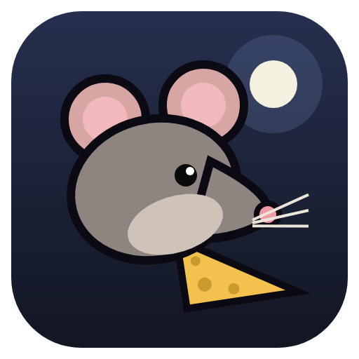

# Kitchen Rat

A stealth game about a mother rat who sneaks into a different room of the house every night to feed
her hungry pups. Every theft leaves evidence, and the house fights back GTA-style: the more you steal,
the higher your wanted level, from a sleepy cat to the owner with a flashlight, mousetraps, poisoned
cheese and a robot vacuum.



## Download and play

No installation, no setup. Download one file and run it.

| System | Download | How to run |
|---|---|---|
| **Windows** | [KitchenRat-Windows.exe](https://github.com/SergeyChere/kitchen-rat/releases/latest/download/KitchenRat-Windows.exe) | Double-click. If Windows shows "Windows protected your PC", click **More info → Run anyway** |
| **Mac (Apple Silicon)** | [KitchenRat-Mac-arm64.dmg](https://github.com/SergeyChere/kitchen-rat/releases/latest/download/KitchenRat-Mac-arm64.dmg) | Open the .dmg, then right-click Kitchen Rat → **Open** |
| **Mac (Intel)** | [KitchenRat-Mac-x64.dmg](https://github.com/SergeyChere/kitchen-rat/releases/latest/download/KitchenRat-Mac-x64.dmg) | Same as above |
| **Linux** | [KitchenRat-Linux.AppImage](https://github.com/SergeyChere/kitchen-rat/releases/latest/download/KitchenRat-Linux.AppImage) | `chmod +x KitchenRat-Linux.AppImage`, then run it |

These links always point to the newest release. All versions: [Releases](https://github.com/SergeyChere/kitchen-rat/releases).

**Скачать и играть (RU):** для Windows скачай [KitchenRat-Windows.exe](https://github.com/SergeyChere/kitchen-rat/releases/latest/download/KitchenRat-Windows.exe) и запусти двойным кликом. Ничего устанавливать не нужно. Если появится окно «Windows защитила ваш компьютер», нажми **Подробнее → Выполнить в любом случае**.

## For developers

### Run from source

You need [Node.js](https://nodejs.org) 20 or newer.

```bash
git clone https://github.com/SergeyChere/kitchen-rat.git
cd kitchen-rat
npm install
npm start
```

### Build an installer

| Platform | Command | Output in `dist/` |
|---|---|---|
| Windows | `npm run dist:win` | `KitchenRat-Windows.exe` (portable) and `KitchenRat-Setup.exe` (installer) |
| macOS | `npm run dist:mac` | `.dmg` |
| Linux | `npm run dist:linux` | `.AppImage` |

Build each platform on that platform. GitHub also builds all of them on every push to `main`
(downloads on the workflow run page). To publish a new downloadable version, bump `version` in
`package.json`, push, then on GitHub open **Releases → Draft a new release**, type a new tag such as
`v0.2.0` and click **Publish release**. The workflow builds the game and attaches the files to that
release (takes about 10 minutes), and the download links above switch to it automatically.

### In a browser

Open `game/index.html` directly. Everything it needs is in `game/vendor/`, so it works offline.

## The nights

The full game will have 20 nights in four acts. Nights 1–3 are playable now; the rest show up in the
Nights menu as "in development". The plan is in the design doc.

| Night | Room | Food | What's new |
|---|---|---|---|
| 1 | The Kitchen | 15 | The full first chapter: nobody is home, 12 tasks that teach everything (jumping, sneaking, hiding, sniffing, knocking things over), traps that make noise (a mug on the table edge, crinkly foil), two side tasks and a secret |
| 2 | The Sleeping Cat | 12 | Food is scattered around the living room and the cat sleeps by your hole. Noise drains its sleep meter: running, bumping into things and jumping down from tables wake it up |
| 3 | The Prowling Cat | 12 | Same room, but the cat is awake and walking around. Stay out of its sight cone and hide |

Tasks for the night show up one at a time in the bottom-left corner. Each night has three goals (for example "Don't wake the cat" or "Never get caught"). Finishing a
night unlocks the next one; progress and settings are saved automatically.

## Settings

Mouse sensitivity, invert Y, field of view, music and sound effect volume, graphics quality
(High: bloom and shadows, Medium: no bloom, Low: no post effects or shadows), and hints on/off.
Open them from the main menu or the pause menu.

## Controls

| Action | Key |
|---|---|
| Move | `WASD` / arrow keys |
| Camera | Mouse (click the game to capture the cursor) |
| Jump onto furniture | `Space` when the yellow ring shows |
| Sniff (find cheese, spot poison and traps) | `E` or right mouse button |
| Knock something off a table (distraction) | `F` |
| Run (loud) | `Shift` |
| Sneak (silent, slow) | hold `Ctrl` or press `C` |
| Pause / release the cursor | `Esc` |
| Fullscreen (desktop app) | `F11` |
| Developer tools (desktop app) | `Ctrl+Shift+I` |

## Project layout

```
game/            The game itself (three.js r128), runs offline
  index.html     Markup, styles and menus
  js/audio.js    Synthesized sound effects and adaptive music (Web Audio, no audio files)
  js/levels.js   The nights: furniture, food, cat, goals, palettes, music. Add a night here
  js/game.js     Room builder, rat, cat, owner, vacuum, wanted level, cutscenes, menus
  vendor/        three.js and fonts
electron/        Desktop shell: window, fullscreen, quit button bridge
build/icon.png   App icon (used by the window and the installers)
unity/           Unity port in progress (C#). Behind the HTML version, see unity/README.md
docs/            Game design notes and roadmap
.github/         CI that builds the desktop app for Windows, macOS and Linux
```

The HTML version is where new gameplay ideas get tried first. Features that stick get ported to
Unity, which is the long-term engine for the Steam release.

## Credits

- 3D engine: [three.js](https://threejs.org) r128 (MIT), in `game/vendor/three/`
- Fonts: Fredoka and Rubik (SIL Open Font License), in `game/vendor/fonts/`
